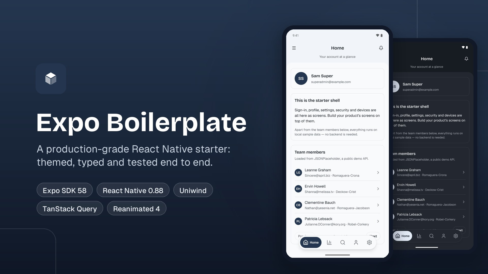

# Expo Boilerplate

A production-grade React Native starter on **Expo SDK 58**. It ships a complete app shell (onboarding, sign-in, a collapsing header, drawer and floating tab navigation), three themes, a 70-component UI kit, a PDF viewer, a QR scanner and a live API example. It is typed end to end, tested, and runs in **Expo Go** with no backend.


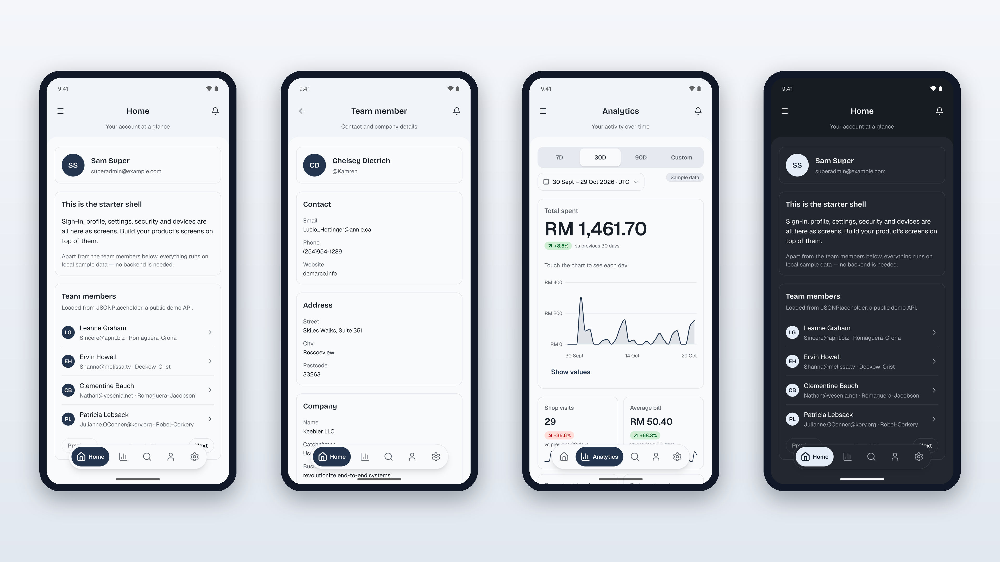

## Contents

- [Features](#features)
- [Screenshots](#screenshots)
- [Tech stack](#tech-stack)
- [Getting started](#getting-started)
- [Configuration](#configuration)
- [Scripts](#scripts)
- [Project structure](#project-structure)
- [How it works](#how-it-works)
- [Testing and quality gate](#testing-and-quality-gate)
- [Troubleshooting](#troubleshooting)
- [Contributing](#contributing)

## Features

| Area | What you get |
|---|---|
| **App shell** | Onboarding, then sign-in, sign-up and forgot-password. Signed-in screens share one page header that collapses as you scroll, a side drawer and a floating tab bar. Tabs preload on idle, so the first switch is instant. |
| **Edge to edge** | The app draws under the status bar and navigation bar, and the status bar icons follow the theme. |
| **Theming** | Light, Dark and Nord themes, or follow the system. The tokens are generated from one source (`src/tokens/`) and applied with Uniwind. |
| **UI kit** | 70+ accessible components in `src/ui/`: buttons, fields, date pickers, sheets, dialogs, toasts, skeletons, charts, tables, timelines and more. They are browsable in-app under **Settings → Components**. |
| **Data** | TanStack Query for server state, with a live example: Home lists team members from [JSONPlaceholder](https://jsonplaceholder.typicode.com) with server-side pagination (Previous / Next, with the page in the URL as `?page=`; the current page stays on screen while the next loads). Tapping a person opens their details page (contact, address, company). Responses are parsed with zod and each page and person is cached. Skeleton loaders, retry, a not-found state and pull-to-refresh are included. |
| **Forms** | TanStack Form with zod validation: sign-in, sign-up, forgot password, change password, profile. |
| **Account** | Profile, security (change password), signed-in devices with revoke and "sign out everywhere", all on local sample data. |
| **Analytics** | An activity dashboard with 7-day, 30-day, 90-day and custom ranges, an interactive chart and stat tiles. |
| **Documents** | A PDF viewer (pick a file or open a sample) and a QR scanner that copies results and opens links. |
| **Quality** | Strict TypeScript (tsrs), type-aware oxlint with house rules, oxfmt, and 1,100+ jest-expo tests. |

## Screenshots

All screens below were captured from the app running in Expo Go (Android, Pixel 9 Pro XL).

### Team members (live API)

| List with pagination | Page 2 | Details loading | Team member |
|:---:|:---:|:---:|:---:|
| 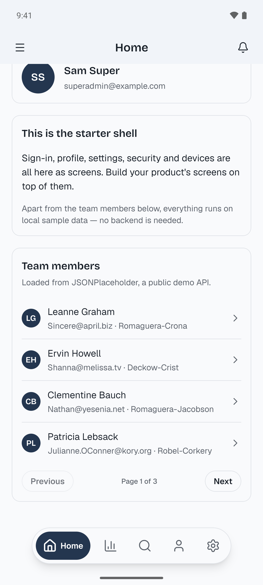 |  | 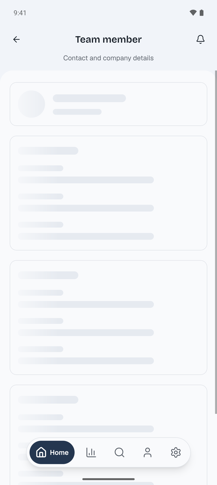 | 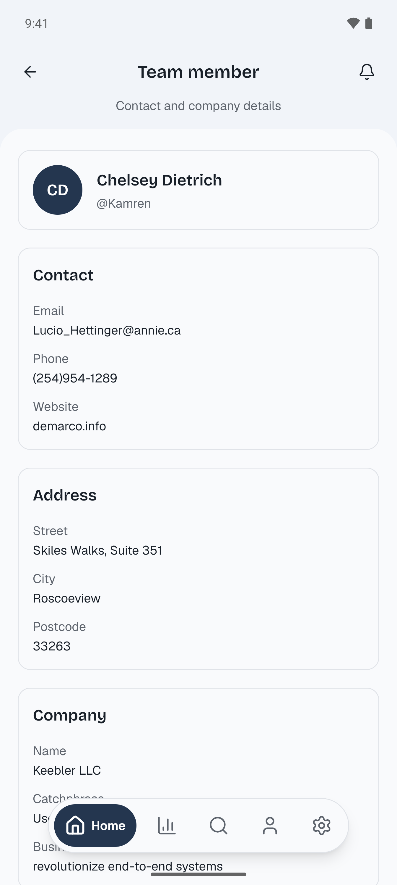 |

### Onboarding and sign-in

| Onboarding | Sign in | Home | Home (dark) |
|:---:|:---:|:---:|:---:|
| 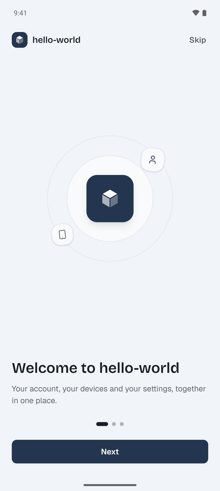 | 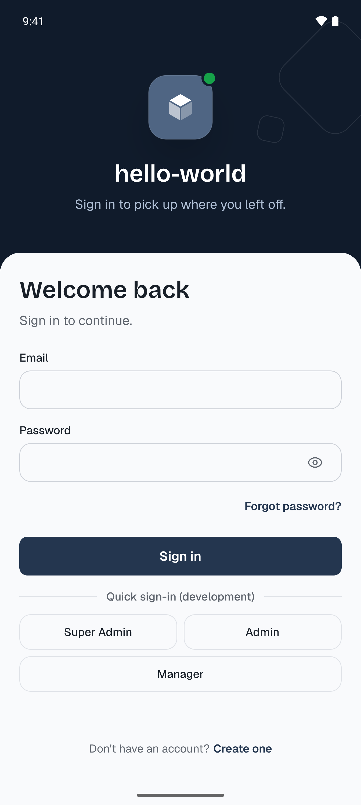 | 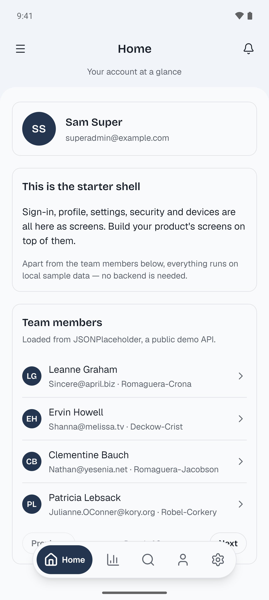 | 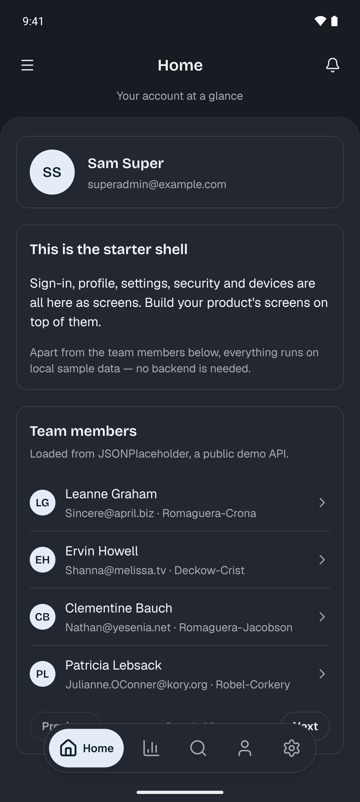 |

### Navigation and tabs

| Drawer | Analytics | Analytics (Nord) | Search |
|:---:|:---:|:---:|:---:|
| 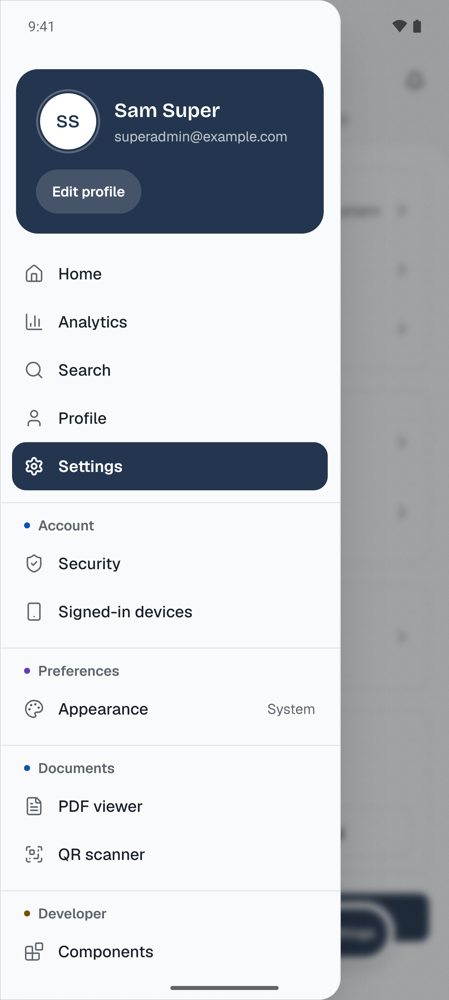 | 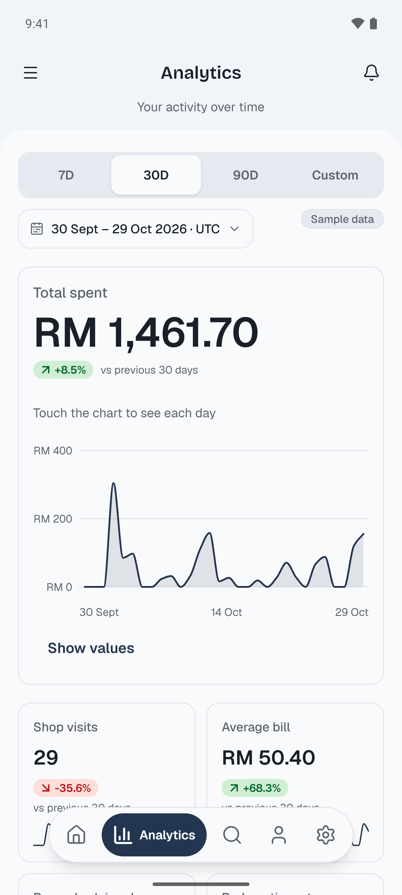 | 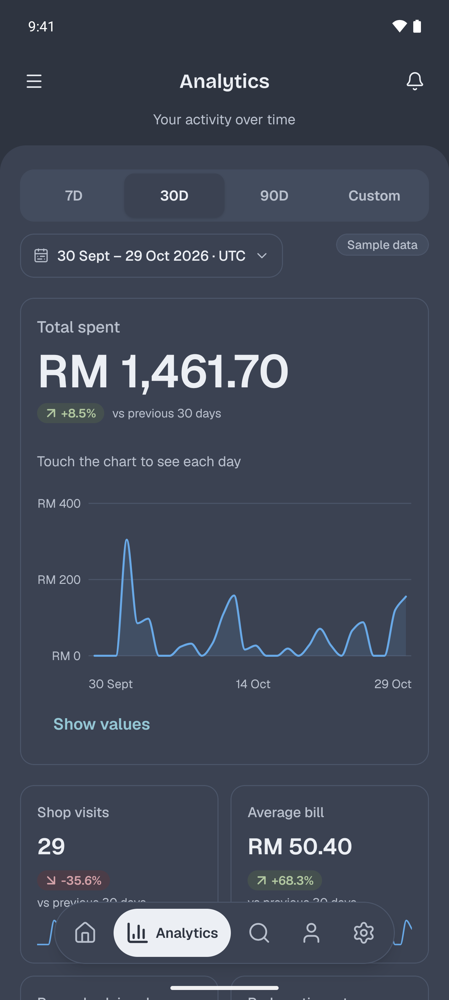 | 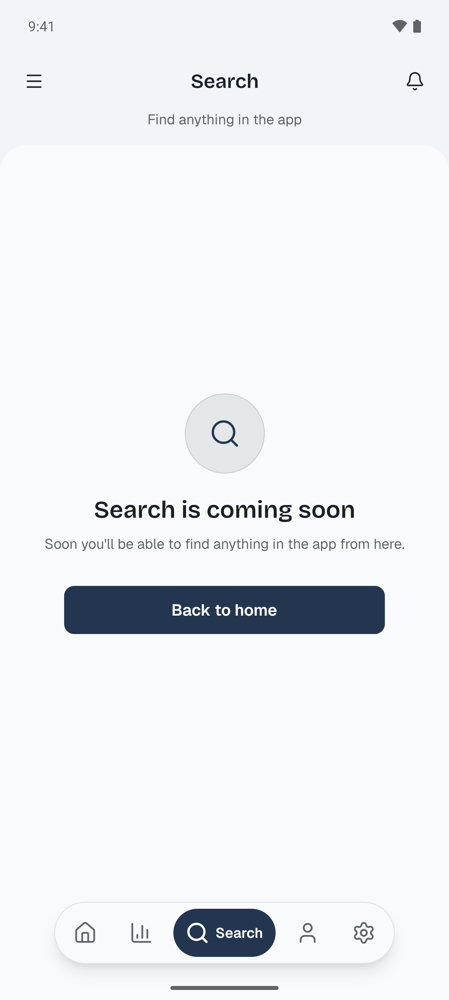 |

### Account and settings

| Profile | Settings | Security | Signed-in devices |
|:---:|:---:|:---:|:---:|
| 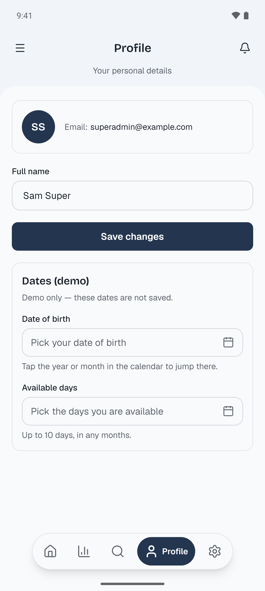 | 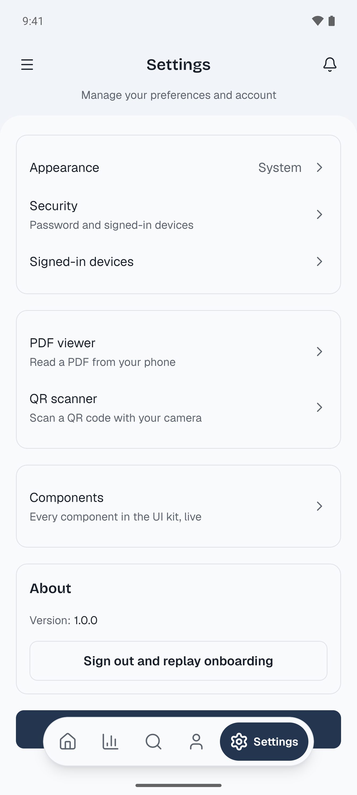 | 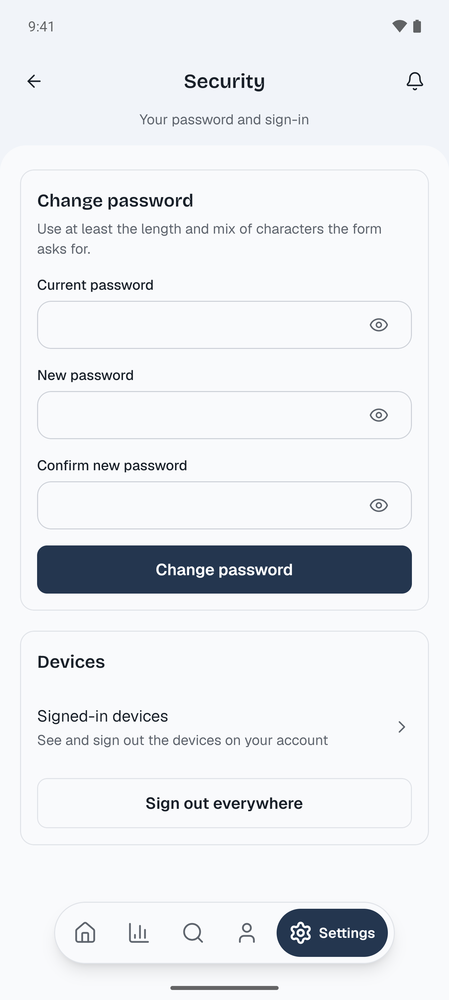 | 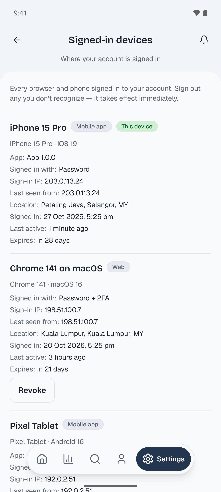 |

### Tools

| Appearance | Components | PDF viewer | QR scanner |
|:---:|:---:|:---:|:---:|
| 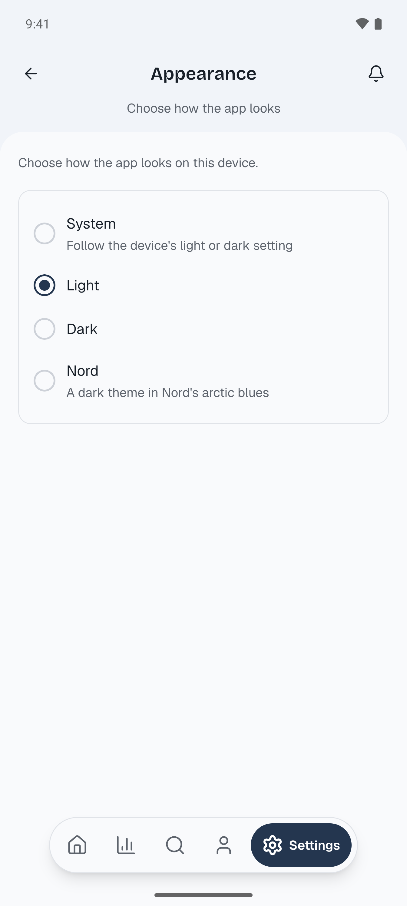 | 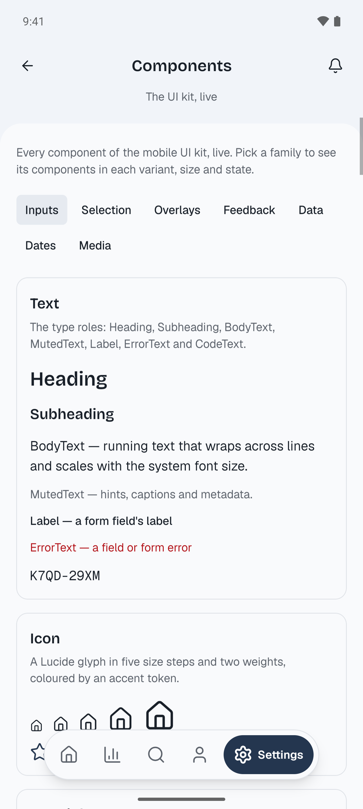 | 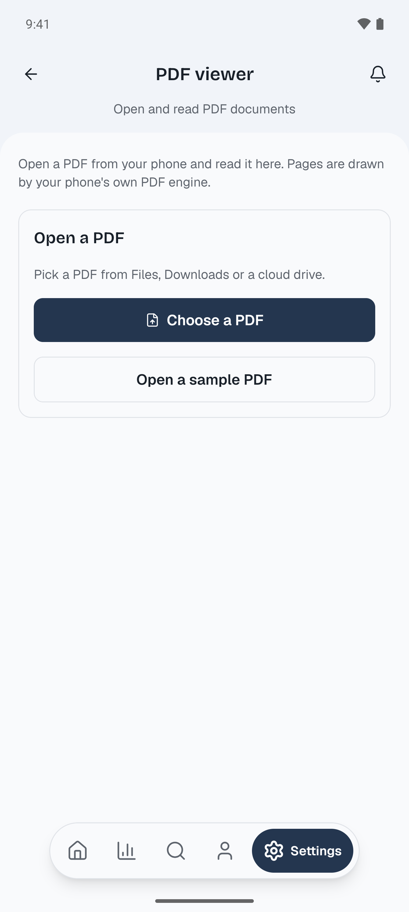 | 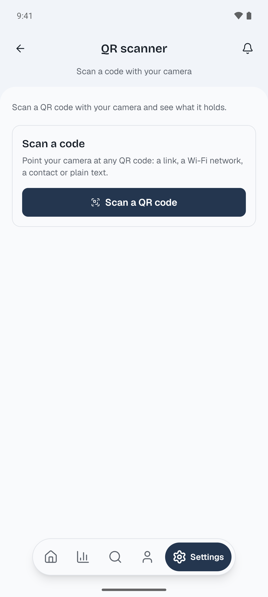 |

## Tech stack

| Concern | Choice |
|---|---|
| Runtime | Expo SDK 58 · React Native 0.88 · React 19.3 · Hermes |
| Routing | Expo Router (typed routes) |
| Styling | Uniwind (Tailwind CSS v4) with generated design tokens |
| Server state | TanStack Query 5 |
| Forms | TanStack Form + zod 4 |
| Client state | Zustand 5 feature stores (reducer + facade pattern) |
| URL state | nuqs, through `src/lib/url-state` (`defineUrlState` / `useUrlState`) with a custom Expo Router adapter |
| Animation | Reanimated 4 + react-native-worklets |
| Icons and fonts | Lucide · Geist, Bricolage Grotesque, Geist Mono |
| Device | expo-camera, expo-secure-store, expo-file-system, expo-document-picker, expo-sharing, expo-haptics |
| Tooling | pnpm 12 · tsrs (type checker) · oxlint (type-aware) · oxfmt · jest-expo |

## Getting started

### Prerequisites

- **Node.js 24** and **pnpm 12**
- **Expo Go 58.0.5 or newer** on your phone ([Android](https://play.google.com/store/apps/details?id=host.exp.exponent) · [iOS](https://apps.apple.com/app/expo-go/id982107779)), or an Android emulator / iOS simulator

### Run it

```bash
pnpm install
pnpm start            # Metro with a clean cache; scan the QR code with Expo Go
pnpm android          # or open straight on an Android device/emulator
pnpm ios              # or on an iOS simulator
```

Skip the onboarding, then use one of the **Quick sign-in** buttons (Super Admin, Admin or Manager). They appear only in development builds. The demo session lives in memory, so a full reload signs you out.

## Configuration

The app reads its settings from `.env` (git-ignored; copy `.env.example`). Every variable is
explained in `.env.example`; the same variables as the starter kit's mobile app, plus
`EXPO_PUBLIC_API_JSON_PLACEHOLDER`.

| Variable | Read by | Default | What it does |
|---|---|---|---|
| `EXPO_PUBLIC_API_URL` | `src/lib/env.ts` | empty: no API | The API's `https://` address. Left empty here: this app is not connected to an API yet |
| `EXPO_PUBLIC_API_PORT` | `src/lib/env.ts` | `8080` | Added to an `http://` API address that names no port (development, or a LAN test APK) |
| `EXPO_PUBLIC_ALLOW_LAN_HTTP_API` | `src/lib/env.ts`, `app.config.ts` | off | `true`: a release build may use `http://` to a private LAN address (a test APK; run `expo prebuild` after changing it). Never for a store build |
| `EXPO_PUBLIC_IOS_STORE_URL`, `EXPO_PUBLIC_ANDROID_STORE_URL` | `src/lib/env.ts` | empty | Store pages for an "Update required" screen (`https://` only) |
| `EXPO_PUBLIC_SHOW_DEMO_ACCOUNT` | `src/lib/env.ts` | off | `true`: the quick sign-in buttons in a release build too (a test APK; the demo passwords are then inside it) |
| `EXPO_PUBLIC_API_JSON_PLACEHOLDER` | `src/lib/env.ts` | `https://jsonplaceholder.typicode.com` | The public demo API the Team list reads (`https://` only) |
| `MOBILE_APP_NAME`, `MOBILE_APP_SLUG`, `MOBILE_BUNDLE_ID`, `MOBILE_SCHEME` | `app.config.ts` | `app.json`'s values | The app's name, Expo slug, package / bundle id and URL scheme. Rename the app here, never in code |

`EXPO_PUBLIC_*` values are baked into the app when it is bundled and are public: never put a secret
in one. A value the app does not accept shows a configuration error screen naming the variable and
an example; a wrong `MOBILE_*` value stops `expo start` with the variable's name. Change a value,
then restart Expo (`pnpm start`), or rebuild an installed app. Building an APK, AAB or iOS app:
[docs/building-installable-apps.md](docs/building-installable-apps.md).

## Scripts

| Command | What it does |
|---|---|
| `pnpm start` | Start Metro (always with `--clear`) |
| `pnpm android` / `pnpm ios` | Start Metro and open the app on a device or simulator |
| `pnpm format` | Format with oxfmt (sorts Tailwind classes), then `oxlint --fix` |
| `pnpm lint` | Format check, then type-aware oxlint — must report zero warnings |
| `pnpm typecheck` | `tsrs --noEmit` |
| `pnpm test` | jest-expo test suite |
| `pnpm tokens:generate` | Rebuild `src/styles/tokens.css` and launch colours from `src/tokens/` |
| `pnpm prebuild` | Generate the native `ios/` and `android/` projects |

## Project structure

```text
index.ts                 entry point: URL polyfill, then Expo Router
global.css               Tailwind + Uniwind + generated tokens + font utilities
src/
  app/                   routes (Expo Router)
    (auth)/              sign-in, sign-up, forgot-password
    (app)/               signed-in screens: (home)/ (Home + team/[id]), analytics, search, profile, settings/*
    onboarding.tsx
  runtime/               app runtime, root providers, root navigator and guard
  features/              app features, one folder each
    app-shell/           shared header, scroll-linked collapse, layout
    app-drawer/          side drawer
    navigation/          floating tab bar, route headings, tab preloading
    preferences/         theme preference (Zustand store + secure-store persistence)
    session/             demo session store
    sample-users/        live API example: paged list + details (fetch + zod + TanStack Query + skeletons)
    pdf-viewer/  qr-scanner/  component-gallery/  toast/
  contexts/              domain areas: identity (auth, devices, profile), reporting
  components/            app-level building blocks: Screen, PageHeader, drawer, tab bar, charts
  lib/                   query client, fonts, secure store, motion helpers
  ui/                    the UI kit (components + lib)
  tokens/                design-token source → src/styles/tokens.css
  shared/                shared schemas and helpers
modules/pdf-renderer/    local Expo module for native PDF rendering
config-plugins/          Expo config plugins
rules/                   engineering rules (read by humans and AI agents)
docs/                    guides and images
test/                    Jest fakes and harness for native boundaries
```

## How it works

- **Entry point.** `package.json` `main` is `index.ts`. It loads `react-native-url-polyfill` first (React Native's `URL` is incomplete), then `expo-router/entry`.
- **Routing and guard.** `src/runtime/` restores preferences, applies the theme and picks the first route: onboarding, sign-in or the app. Typed routes come from Expo Router.
- **App shell.** Every signed-in screen renders inside `<Screen>`, which sits under one shared `PageHeader`. Scrolling drives a Reanimated shared value: the subtitle fades and the header slims down, while the menu, title and bell stay visible. Content sits on a sheet with a curved top.
- **Styling.** Use only `className` utilities over semantic tokens (`bg-card`, `text-muted-foreground`, …). Colour literals and inline style objects fail lint. Colour props take `accent-*` classes. Third-party components get `withUniwind(...)` once.
- **Themes.** Edit `src/tokens/`, run `pnpm tokens:generate`, and Uniwind switches between `light`, `dark` and `nord` at runtime. A test fails if the generated CSS is stale.
- **Server state.** Each feature centralises its query keys and parses responses with zod once, at the boundary. See `src/features/sample-users/` for the full pattern: a paged list (`useSampleUsersPage`, keyed by page and page size, keeping the previous page as placeholder data) and a detail query (`useSampleUserDetails`, keyed by id). It never retries a 404.
- **URL state.** Shareable, deep-linkable screen state (a list's page, filters, sort) lives in the route's params, not in `useState`. Declare it once with `defineUrlState` (zod per param; a bad or missing value falls back to its default), then read and write it with `useUrlState`. The engine is [nuqs](https://nuqs.dev) behind a custom Expo Router adapter (`src/lib/url-state/url-state-provider.tsx`), so screens never import nuqs. Home's page works this way: `/?page=2` opens page 2, and a page past the end settles on the last one. On a phone, updates replace the screen's params in place, so Back leaves the screen instead of stepping through pages. URL state is for deep links and shareable state; it doesn't survive an app restart.
- **Dynamic routes.** Routes with a parameter (`/team/[id]`) live in `DYNAMIC_ROUTES` (`src/runtime/routes.ts`). They are pushed through an href helper (`teamMemberHref(id)`), and their params are parsed with zod before use.
- **Storage.** Use `expo-secure-store` only, with values parsed by zod on read. Never AsyncStorage.
- **Expo Go limits.** The QR scanner works in Expo Go. The PDF viewer's native page renderer needs a development build; in Expo Go it falls back to opening the PDF in another app.

## Testing and quality gate

Tests sit next to the code in `__tests__/` folders. `jest.setup.ts` mocks only native boundaries (secure store, Uniwind, blur, keyboard, worklets, file system, camera).

Every change must pass, in order:

```bash
pnpm run lint                    # zero errors, zero warnings
pnpm run typecheck               # zero errors
pnpm run test                    # all green
pnpm exec expo install --check   # Expo SDK versions aligned
```

Disabling a rule, `@ts-ignore`, casts and skipped tests are not accepted ways to pass the gate.

## Troubleshooting

| Problem | Fix |
|---|---|
| Expo Go shows a blue **"Something went wrong"** screen | Expo Go is older than SDK 58. Update it from the store. |
| The phone can't reach Metro | Phone and computer must share a network; try `pnpm start --tunnel`. |
| `pnpm install` refuses a fresh release | pnpm's `minimumReleaseAge` requires a version to be a day old. Wait, or approve it interactively. |
| Styles or tokens look stale | `pnpm tokens:generate`, then `pnpm start` (it always clears Metro's cache). |

## Contributing

Read [`AGENTS.md`](AGENTS.md) first, then the documents in [`rules/`](rules/) it routes you to. `CLAUDE.md` and `.cursor/rules/` point AI coding agents at the same rules. Porting notes for the turborepo starter are in [`docs/mobile-shell-porting-guide.md`](docs/mobile-shell-porting-guide.md).
